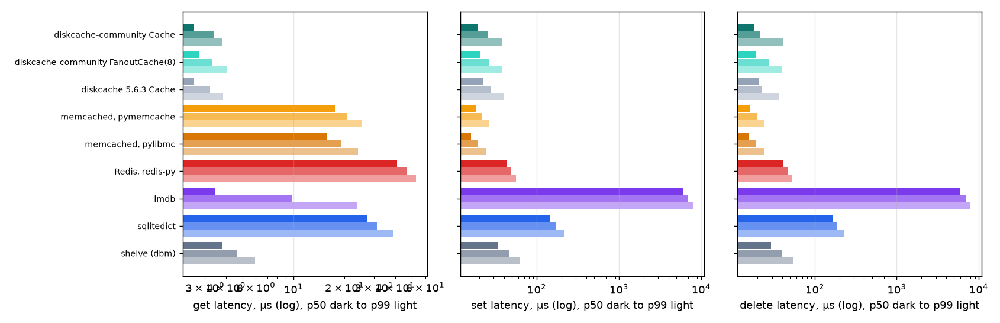
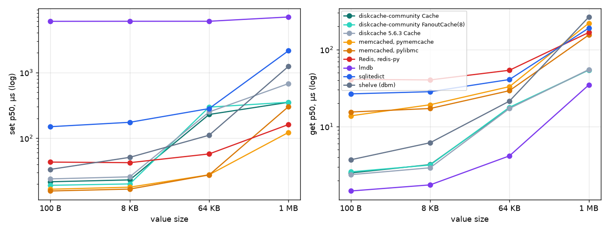
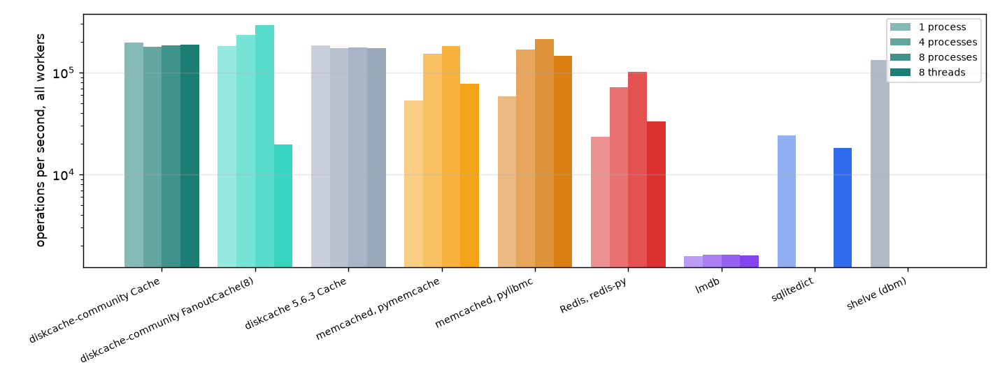
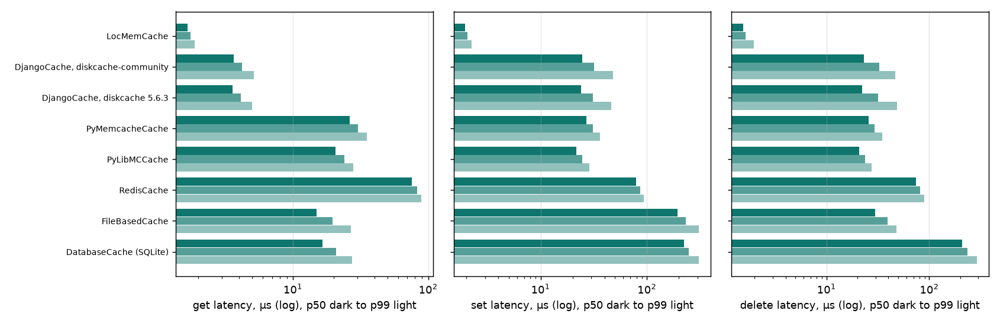

DiskCache Benchmarks
====================

Measured on 2026-10-12 with the published diskcache-community 5.7.0 wheel.
Every number below comes from the scripts in ``tests/benchmarks`` of the
repository; the last section says how to run them. Treat the results as what
they are: one machine, synthetic workloads, short keys. They show the shape of
the costs, not what your application will see.

The previous pages, :doc:`cache-benchmarks` and :doc:`djangocache-benchmarks`,
are the old benchmarks: upstream DiskCache measured them for version 4 in
2019, on other hardware and against other versions of every store. They stay
for reference; the classic mix below repeats their workload.

Each store runs the same seeded operation sequence. Latencies are measured per
operation with the nanosecond performance counter and reported at the 50th,
90th and 99th percentiles and the maximum. Every workload runs once to warm up
and then five times (three for the multi-process and threaded workloads); the
tables show the median run, and the "p50 across runs" column shows how much
the median moved between runs. memcached runs with its item size limit raised
to 4 MB for the 1 MB tier and Redis with persistence off; both are separate
processes on localhost, so their numbers include a round trip over the
loopback interface. Every other store uses its default settings, and the notes
under each section say where a default matters.

Environment
-----------

- CPU: Apple M5 Pro, 18 cores
- OS: macOS 27.0.1, arm64
- Python: CPython 3.14.8
- SQLite: 3.53.4
- memcached: memcached 1.6.45
- Redis: 8.10.2
- diskcache-community Cache: diskcache-community 5.7.0
- diskcache-community FanoutCache(8): diskcache-community 5.7.0
- diskcache 5.6.3 Cache: diskcache 5.6.3
- memcached, pymemcache: pymemcache 4.0.0
- memcached, pylibmc: pylibmc 1.6.3, libmemcached 1.0.18
- Redis, redis-py: redis-py 8.1.0 with hiredis
- lmdb: py-lmdb 3.0.0, liblmdb 0.9.36
- sqlitedict: sqlitedict 2.1.0
- shelve (dbm): shelve over dbm.sqlite3, Python 3.14.8
- Django 6.0.9

diskcache-community and diskcache 5.6.3
---------------------------------------

The same workloads, run against the fork and against the last upstream
release in separate environments on the same machine. For latencies a negative
change favours the fork; for operations per second a positive one does.

.. list-table:: diskcache-community against diskcache 5.6.3
   :header-rows: 1
   :widths: 34 18 20 10

   * - Measure
     - diskcache 5.6.3
     - diskcache-community
     - change
   * - Classic mix, get p50
     - 2.6 µs
     - 2.6 µs
     - +0 %
   * - Classic mix, set p50
     - 22.3 µs
     - 19.2 µs
     - -14 %
   * - Classic mix, delete p50
     - 20.5 µs
     - 18.4 µs
     - -11 %
   * - Classic mix, ops per second
     - 185562
     - 197044
     - +6 %
   * - 100-byte values, set p50
     - 24.0 µs
     - 21.7 µs
     - -10 %
   * - 64 KB values, set p50
     - 250.9 µs
     - 229.5 µs
     - -9 %
   * - 1 MB values, set p50
     - 676.4 µs
     - 351.3 µs
     - -48 %
   * - 1 MB values, get p50
     - 55.0 µs
     - 54.4 µs
     - -1 %
   * - 95 % hits, get p50
     - 2.8 µs
     - 3.2 µs
     - +12 %
   * - 8 processes, set p50
     - 22.8 µs
     - 20.3 µs
     - -11 %
   * - 8 threads, ops per second
     - 174210
     - 188028
     - +8 %
   * - Django, get p50
     - 3.6 µs
     - 3.7 µs
     - +2 %
   * - Django, set p50
     - 24.1 µs
     - 24.8 µs
     - +3 %

The classic mix
---------------

The workload of the original 2016 page, kept so the two can be compared: keys
drawn from a space of 100, values of up to about 600 bytes, 90 % gets, 9 %
sets and 1 % deletes, 100,000 operations after a 1,000-operation warm-up, in
one process. The ~1 % miss rate comes from gets after deletes.

.. list-table:: Get latency, classic mix
   :header-rows: 1
   :widths: 30 10 18 10 10 10 8

   * - Store
     - p50
     - p50 across runs
     - p90
     - p99
     - max
     - misses
   * - diskcache-community Cache
     - 2.6 µs
     - 2.6 µs to 2.6 µs
     - 3.4 µs
     - 3.8 µs
     - 36.6 µs
     - 8714
   * - diskcache-community FanoutCache(8)
     - 2.8 µs
     - 2.8 µs to 2.8 µs
     - 3.3 µs
     - 4.0 µs
     - 26.8 µs
     - 8714
   * - diskcache 5.6.3 Cache
     - 2.6 µs
     - 2.5 µs to 2.6 µs
     - 3.2 µs
     - 3.8 µs
     - 27.1 µs
     - 8714
   * - memcached, pymemcache
     - 17.6 µs
     - 17.5 µs to 17.7 µs
     - 20.8 µs
     - 25.4 µs
     - 130.4 µs
     - 8714
   * - memcached, pylibmc
     - 15.7 µs
     - 15.6 µs to 15.7 µs
     - 19.0 µs
     - 24.0 µs
     - 72.6 µs
     - 8714
   * - Redis, redis-py
     - 40.9 µs
     - 40.8 µs to 41.3 µs
     - 46.6 µs
     - 52.8 µs
     - 274.2 µs
     - 8714
   * - lmdb
     - 3.4 µs
     - 3.4 µs to 3.5 µs
     - 9.8 µs
     - 23.6 µs
     - 185.4 µs
     - 8714
   * - sqlitedict
     - 27.2 µs
     - 27.1 µs to 27.3 µs
     - 31.0 µs
     - 38.7 µs
     - 109.8 µs
     - 8714
   * - shelve (dbm)
     - 3.8 µs
     - 3.8 µs to 3.8 µs
     - 4.6 µs
     - 5.9 µs
     - 17.8 µs
     - 8714

.. list-table:: Set latency, classic mix
   :header-rows: 1
   :widths: 30 10 18 10 10 10 8

   * - Store
     - p50
     - p50 across runs
     - p90
     - p99
     - max
     - misses
   * - diskcache-community Cache
     - 19.2 µs
     - 19.2 µs to 19.9 µs
     - 25.4 µs
     - 37.3 µs
     - 623.2 µs
     - 0
   * - diskcache-community FanoutCache(8)
     - 20.5 µs
     - 20.3 µs to 20.9 µs
     - 26.5 µs
     - 38.1 µs
     - 1.02 ms
     - 0
   * - diskcache 5.6.3 Cache
     - 22.3 µs
     - 22.1 µs to 22.4 µs
     - 28.0 µs
     - 39.4 µs
     - 789.1 µs
     - 0
   * - memcached, pymemcache
     - 18.5 µs
     - 18.3 µs to 18.6 µs
     - 21.3 µs
     - 25.9 µs
     - 60.1 µs
     - 0
   * - memcached, pylibmc
     - 16.0 µs
     - 16.0 µs to 16.1 µs
     - 19.4 µs
     - 24.3 µs
     - 37.2 µs
     - 0
   * - Redis, redis-py
     - 43.6 µs
     - 43.4 µs to 43.7 µs
     - 48.5 µs
     - 55.7 µs
     - 133.5 µs
     - 0
   * - lmdb
     - 5.98 ms
     - 5.97 ms to 5.99 ms
     - 6.90 ms
     - 8.02 ms
     - 14.69 ms
     - 0
   * - sqlitedict
     - 147.0 µs
     - 146.5 µs to 148.6 µs
     - 170.5 µs
     - 217.3 µs
     - 1.22 ms
     - 0
   * - shelve (dbm)
     - 34.3 µs
     - 33.8 µs to 35.0 µs
     - 46.7 µs
     - 62.5 µs
     - 2.29 ms
     - 0

.. list-table:: Delete latency, classic mix
   :header-rows: 1
   :widths: 30 10 18 10 10 10 8

   * - Store
     - p50
     - p50 across runs
     - p90
     - p99
     - max
     - misses
   * - diskcache-community Cache
     - 18.4 µs
     - 18.2 µs to 18.6 µs
     - 21.4 µs
     - 40.8 µs
     - 569.9 µs
     - 111
   * - diskcache-community FanoutCache(8)
     - 19.3 µs
     - 19.1 µs to 19.4 µs
     - 27.2 µs
     - 40.2 µs
     - 897.4 µs
     - 111
   * - diskcache 5.6.3 Cache
     - 20.5 µs
     - 20.5 µs to 20.6 µs
     - 22.5 µs
     - 37.1 µs
     - 518.0 µs
     - 111
   * - memcached, pymemcache
     - 16.4 µs
     - 16.4 µs to 16.7 µs
     - 19.8 µs
     - 24.5 µs
     - 30.5 µs
     - 111
   * - memcached, pylibmc
     - 15.6 µs
     - 15.5 µs to 15.8 µs
     - 19.0 µs
     - 24.2 µs
     - 29.3 µs
     - 111
   * - Redis, redis-py
     - 41.4 µs
     - 41.0 µs to 41.5 µs
     - 46.6 µs
     - 52.4 µs
     - 74.3 µs
     - 111
   * - lmdb
     - 5.96 ms
     - 5.95 ms to 5.97 ms
     - 6.90 ms
     - 7.96 ms
     - 10.96 ms
     - 111
   * - sqlitedict
     - 164.3 µs
     - 163.5 µs to 164.8 µs
     - 188.2 µs
     - 230.1 µs
     - 466.0 µs
     - 111
   * - shelve (dbm)
     - 29.0 µs
     - 28.8 µs to 29.5 µs
     - 39.1 µs
     - 54.4 µs
     - 118.9 µs
     - 111

.. list-table:: Throughput and footprint, classic mix
   :header-rows: 1
   :widths: 30 14 12 20

   * - Store
     - ops per second
     - wall time
     - on disk after the run
   * - diskcache-community Cache
     - 197044
     - 0.50 s
     - 4 MB
   * - diskcache-community FanoutCache(8)
     - 182771
     - 0.54 s
     - 32 MB
   * - diskcache 5.6.3 Cache
     - 185562
     - 0.53 s
     - 4 MB
   * - memcached, pymemcache
     - 53497
     - 1.85 s
     - server
   * - memcached, pylibmc
     - 58268
     - 1.70 s
     - server
   * - Redis, redis-py
     - 23519
     - 4.21 s
     - server
   * - lmdb
     - 1592
     - 62.17 s
     - 192 KB
   * - sqlitedict
     - 24246
     - 4.08 s
     - 64 KB
   * - shelve (dbm)
     - 131608
     - 0.75 s
     - 4 MB

lmdb's writes stand out because its defaults, ``sync`` and ``metasync`` on,
end every write transaction with two full disk flushes (``F_FULLFSYNC`` on
macOS), about 6 ms together on this machine; its reads are the fastest here.
It is the only store in the table that forces each write onto the disk before
returning. DiskCache runs SQLite in WAL mode with ``synchronous`` NORMAL,
which flushes at checkpoints, sqlitedict commits every operation through
SQLite's default rollback journal, and memcached and Redis keep data in
memory.

Value sizes
-----------

Sets followed by gets at four value sizes. The 64 KB and 1 MB tiers cross
DiskCache's default 32 KB threshold above which values live in files next to
the database; memcached was started with its item size limit raised to 4 MB
for the 1 MB tier.

.. list-table:: 100-byte values, 20,000 sets then 20,000 gets over 1,000 keys
   :header-rows: 1
   :widths: 30 12 12 12 12

   * - Store
     - set p50
     - set p99
     - get p50
     - get p99
   * - diskcache-community Cache
     - 21.7 µs
     - 37.0 µs
     - 2.5 µs
     - 3.3 µs
   * - diskcache-community FanoutCache(8)
     - 19.2 µs
     - 36.4 µs
     - 2.6 µs
     - 3.4 µs
   * - diskcache 5.6.3 Cache
     - 24.0 µs
     - 40.9 µs
     - 2.4 µs
     - 3.0 µs
   * - memcached, pymemcache
     - 16.7 µs
     - 24.0 µs
     - 13.8 µs
     - 23.3 µs
   * - memcached, pylibmc
     - 15.7 µs
     - 22.0 µs
     - 15.5 µs
     - 21.8 µs
   * - Redis, redis-py
     - 43.2 µs
     - 52.7 µs
     - 41.0 µs
     - 50.5 µs
   * - lmdb
     - 6.01 ms
     - 8.04 ms
     - 1.5 µs
     - 3.2 µs
   * - sqlitedict
     - 149.5 µs
     - 232.5 µs
     - 26.6 µs
     - 36.6 µs
   * - shelve (dbm)
     - 33.5 µs
     - 56.4 µs
     - 3.7 µs
     - 5.1 µs

.. list-table:: 8 KB values, 20,000 sets then 20,000 gets over 1,000 keys
   :header-rows: 1
   :widths: 30 12 12 12 12

   * - Store
     - set p50
     - set p99
     - get p50
     - get p99
   * - diskcache-community Cache
     - 23.2 µs
     - 44.0 µs
     - 3.2 µs
     - 4.5 µs
   * - diskcache-community FanoutCache(8)
     - 20.1 µs
     - 41.2 µs
     - 3.2 µs
     - 4.7 µs
   * - diskcache 5.6.3 Cache
     - 25.8 µs
     - 48.0 µs
     - 2.9 µs
     - 4.2 µs
   * - memcached, pymemcache
     - 18.0 µs
     - 25.7 µs
     - 19.2 µs
     - 25.7 µs
   * - memcached, pylibmc
     - 16.8 µs
     - 23.4 µs
     - 17.2 µs
     - 23.5 µs
   * - Redis, redis-py
     - 42.4 µs
     - 54.0 µs
     - 40.3 µs
     - 51.7 µs
   * - lmdb
     - 6.02 ms
     - 7.99 ms
     - 1.8 µs
     - 6.7 µs
   * - sqlitedict
     - 174.4 µs
     - 292.0 µs
     - 28.4 µs
     - 39.2 µs
   * - shelve (dbm)
     - 51.1 µs
     - 82.2 µs
     - 6.2 µs
     - 7.8 µs

.. list-table:: 64 KB values, 4,000 sets then 4,000 gets over 500 keys
   :header-rows: 1
   :widths: 30 12 12 12 12

   * - Store
     - set p50
     - set p99
     - get p50
     - get p99
   * - diskcache-community Cache
     - 229.5 µs
     - 399.1 µs
     - 17.4 µs
     - 31.6 µs
   * - diskcache-community FanoutCache(8)
     - 296.9 µs
     - 429.2 µs
     - 17.8 µs
     - 31.1 µs
   * - diskcache 5.6.3 Cache
     - 250.9 µs
     - 419.8 µs
     - 17.2 µs
     - 30.8 µs
   * - memcached, pymemcache
     - 27.7 µs
     - 36.2 µs
     - 33.0 µs
     - 44.3 µs
   * - memcached, pylibmc
     - 27.6 µs
     - 37.8 µs
     - 29.2 µs
     - 37.5 µs
   * - Redis, redis-py
     - 57.5 µs
     - 67.6 µs
     - 53.9 µs
     - 65.5 µs
   * - lmdb
     - 6.02 ms
     - 8.05 ms
     - 4.2 µs
     - 21.1 µs
   * - sqlitedict
     - 282.2 µs
     - 449.3 µs
     - 40.8 µs
     - 51.9 µs
   * - shelve (dbm)
     - 110.9 µs
     - 1.90 ms
     - 21.4 µs
     - 27.6 µs

.. list-table:: 1 MB values, 400 sets then 400 gets over 50 keys
   :header-rows: 1
   :widths: 30 12 12 12 12

   * - Store
     - set p50
     - set p99
     - get p50
     - get p99
   * - diskcache-community Cache
     - 351.3 µs
     - 483.9 µs
     - 54.4 µs
     - 79.7 µs
   * - diskcache-community FanoutCache(8)
     - 352.3 µs
     - 484.6 µs
     - 54.2 µs
     - 81.3 µs
   * - diskcache 5.6.3 Cache
     - 676.4 µs
     - 834.5 µs
     - 55.0 µs
     - 81.7 µs
   * - memcached, pymemcache
     - 122.2 µs
     - 135.9 µs
     - 220.2 µs
     - 238.4 µs
   * - memcached, pylibmc
     - 301.8 µs
     - 319.7 µs
     - 154.8 µs
     - 168.2 µs
   * - Redis, redis-py
     - 161.2 µs
     - 180.4 µs
     - 166.8 µs
     - 192.1 µs
   * - lmdb
     - 6.99 ms
     - 9.04 ms
     - 34.7 µs
     - 211.6 µs
   * - sqlitedict
     - 2.14 ms
     - 2.99 ms
     - 190.1 µs
     - 221.6 µs
   * - shelve (dbm)
     - 1.24 ms
     - 4.35 ms
     - 264.8 µs
     - 307.8 µs

Hit ratio
---------

Gets over a working set of 100,000 keys with 256-byte values, 100,000
operations, at a 95 % and a 50 % hit ratio. Misses are requests for keys that
were never stored.

.. list-table:: Get latency by hit ratio
   :header-rows: 1
   :widths: 30 12 12 12 12 12

   * - Store
     - 95 % hits p50
     - 95 % hits p99
     - 50 % hits p50
     - 50 % hits p99
     - on disk
   * - diskcache-community Cache
     - 3.2 µs
     - 4.3 µs
     - 2.6 µs
     - 4.0 µs
     - 68 MB
   * - diskcache-community FanoutCache(8)
     - 3.1 µs
     - 4.4 µs
     - 2.8 µs
     - 4.3 µs
     - 68 MB
   * - diskcache 5.6.3 Cache
     - 2.8 µs
     - 4.0 µs
     - 2.5 µs
     - 4.0 µs
     - 69 MB
   * - memcached, pymemcache
     - 17.5 µs
     - 24.5 µs
     - 16.8 µs
     - 24.1 µs
     - server
   * - memcached, pylibmc
     - 15.8 µs
     - 22.6 µs
     - 15.6 µs
     - 22.4 µs
     - server
   * - Redis, redis-py
     - 40.0 µs
     - 50.6 µs
     - 40.7 µs
     - 50.8 µs
     - server
   * - lmdb
     - 0.9 µs
     - 1.8 µs
     - 0.7 µs
     - 1.9 µs
     - 49 MB
   * - sqlitedict
     - 27.9 µs
     - 42.7 µs
     - 27.4 µs
     - 41.3 µs
     - 30 MB
   * - shelve (dbm)
     - 5.0 µs
     - 6.7 µs
     - 3.5 µs
     - 6.3 µs
     - 33 MB

Concurrency
-----------

The classic mix from 4 and 8 processes sharing one store, and from 8 threads
in one process, each worker running the full 100,000 operations. sqlitedict and
shelve are single-process stores by design and are left out of the process
workloads; shelve's dbm objects are bound to the thread that opened them, so it
is left out of the thread workload too. The memcached clients are not
thread-safe, so each thread gets its own connection, as pymemcache's
PooledClient and pylibmc's ThreadMappedPool hand out. Cells show get p50 /
set p50.

.. list-table:: Latency under concurrency, get p50 / set p50
   :header-rows: 1
   :widths: 30 16 16 16 16

   * - Store
     - 1 process
     - 4 processes
     - 8 processes
     - 8 threads
   * - diskcache-community Cache
     - 2.6 µs / 19.2 µs
     - 2.6 µs / 20.3 µs
     - 2.6 µs / 20.3 µs
     - 2.5 µs / 20.1 µs
   * - diskcache-community FanoutCache(8)
     - 2.8 µs / 20.5 µs
     - 3.3 µs / 28.8 µs
     - 3.5 µs / 32.9 µs
     - 216.6 µs / 1.26 ms
   * - diskcache 5.6.3 Cache
     - 2.6 µs / 22.3 µs
     - 2.5 µs / 23.0 µs
     - 2.5 µs / 22.8 µs
     - 2.6 µs / 23.8 µs
   * - memcached, pymemcache
     - 17.6 µs / 18.5 µs
     - 23.3 µs / 23.8 µs
     - 38.3 µs / 38.6 µs
     - 88.8 µs / 87.8 µs
   * - memcached, pylibmc
     - 15.7 µs / 16.0 µs
     - 20.6 µs / 20.8 µs
     - 33.3 µs / 33.6 µs
     - 45.9 µs / 46.3 µs
   * - Redis, redis-py
     - 40.9 µs / 43.6 µs
     - 51.8 µs / 55.9 µs
     - 70.8 µs / 75.1 µs
     - 223.1 µs / 224.3 µs
   * - lmdb
     - 3.4 µs / 5.98 ms
     - 3.2 µs / 23.96 ms
     - 3.3 µs / 48.03 ms
     - 4.9 µs / 49.00 ms
   * - sqlitedict
     - 27.2 µs / 147.0 µs
     - not run
     - not run
     - 404.8 µs / 525.9 µs
   * - shelve (dbm)
     - 3.8 µs / 34.3 µs
     - not run
     - not run
     - not run

.. list-table:: Operations per second, all workers together
   :header-rows: 1
   :widths: 30 16 16 16 16

   * - Store
     - 1 process
     - 4 processes
     - 8 processes
     - 8 threads
   * - diskcache-community Cache
     - 197044
     - 179441
     - 184652
     - 188028
   * - diskcache-community FanoutCache(8)
     - 182771
     - 233447
     - 291478
     - 19715
   * - diskcache 5.6.3 Cache
     - 185562
     - 173486
     - 176978
     - 174210
   * - memcached, pymemcache
     - 53497
     - 152049
     - 181101
     - 77380
   * - memcached, pylibmc
     - 58268
     - 169042
     - 211748
     - 146576
   * - Redis, redis-py
     - 23519
     - 71765
     - 101483
     - 32954
   * - lmdb
     - 1592
     - 1636
     - 1625
     - 1600
   * - sqlitedict
     - 24246
     - not run
     - not run
     - 18344
   * - shelve (dbm)
     - 131608
     - not run
     - not run
     - not run

The 8-thread column is dominated by SQLite's behaviour under threads on this
machine: a plain ``SELECT`` through Python's ``sqlite3`` module takes about
2 µs from one thread and about 370 µs from each of eight threads reading the
same database at once, 20,000 queries per second in total, and eight private
``Cache`` objects, one per thread, hit the same wall. The shared ``Cache``
escapes it because its threads queue on one database's write lock, so fewer
of them are inside SQLite at any instant; ``FanoutCache(8)`` spreads writes
over eight databases, keeps all eight threads querying at once and pays the
full cost, in diskcache 5.6.3 exactly as in the fork. The same
``FanoutCache`` under 8 processes is the fastest DiskCache configuration on
the page. sqlitedict pays through the queue in front of its single
connection; lmdb and the memory stores have no such cliff.

Django backends
---------------

The classic mix through Django's cache API with each backend in turn, which
adds Django's key building and versioning on top of every operation.
``DatabaseCache`` uses SQLite; ``RedisCache`` is Django's own backend.

.. list-table:: Get latency, Django backends
   :header-rows: 1
   :widths: 30 10 18 10 10 10 8

   * - Store
     - p50
     - p50 across runs
     - p90
     - p99
     - max
     - misses
   * - LocMemCache
     - 1.7 µs
     - 1.7 µs to 1.7 µs
     - 1.8 µs
     - 1.9 µs
     - 27.1 µs
     - 8714
   * - DjangoCache, diskcache-community
     - 3.7 µs
     - 3.7 µs to 3.7 µs
     - 4.2 µs
     - 5.1 µs
     - 30.5 µs
     - 8714
   * - DjangoCache, diskcache 5.6.3
     - 3.6 µs
     - 3.5 µs to 3.6 µs
     - 4.1 µs
     - 5.0 µs
     - 36.9 µs
     - 8714
   * - PyMemcacheCache
     - 26.3 µs
     - 26.2 µs to 26.5 µs
     - 30.2 µs
     - 35.4 µs
     - 97.2 µs
     - 8714
   * - PyLibMCCache
     - 20.7 µs
     - 20.7 µs to 20.8 µs
     - 23.9 µs
     - 28.0 µs
     - 70.9 µs
     - 8714
   * - RedisCache
     - 75.5 µs
     - 75.1 µs to 76.0 µs
     - 82.5 µs
     - 89.1 µs
     - 247.8 µs
     - 8714
   * - FileBasedCache
     - 14.9 µs
     - 14.8 µs to 15.1 µs
     - 19.6 µs
     - 26.8 µs
     - 61.0 µs
     - 8714
   * - DatabaseCache (SQLite)
     - 16.5 µs
     - 16.4 µs to 16.6 µs
     - 20.9 µs
     - 27.3 µs
     - 51.0 µs
     - 8714

.. list-table:: Set latency, Django backends
   :header-rows: 1
   :widths: 30 10 18 10 10 10 8

   * - Store
     - p50
     - p50 across runs
     - p90
     - p99
     - max
     - misses
   * - LocMemCache
     - 2.0 µs
     - 2.0 µs to 2.0 µs
     - 2.0 µs
     - 2.2 µs
     - 20.5 µs
     - 0
   * - DjangoCache, diskcache-community
     - 24.8 µs
     - 24.7 µs to 24.8 µs
     - 31.7 µs
     - 48.1 µs
     - 713.0 µs
     - 0
   * - DjangoCache, diskcache 5.6.3
     - 24.1 µs
     - 24.1 µs to 24.1 µs
     - 31.2 µs
     - 46.4 µs
     - 1.47 ms
     - 0
   * - PyMemcacheCache
     - 27.0 µs
     - 27.0 µs to 27.1 µs
     - 30.9 µs
     - 36.2 µs
     - 75.5 µs
     - 0
   * - PyLibMCCache
     - 21.7 µs
     - 21.7 µs to 21.7 µs
     - 24.5 µs
     - 28.8 µs
     - 55.3 µs
     - 0
   * - RedisCache
     - 79.2 µs
     - 78.9 µs to 80.0 µs
     - 86.2 µs
     - 94.0 µs
     - 277.0 µs
     - 0
   * - FileBasedCache
     - 193.8 µs
     - 193.7 µs to 196.0 µs
     - 231.7 µs
     - 309.6 µs
     - 1.52 ms
     - 0
   * - DatabaseCache (SQLite)
     - 223.8 µs
     - 222.7 µs to 227.8 µs
     - 248.3 µs
     - 308.2 µs
     - 2.80 ms
     - 0

.. list-table:: Delete latency, Django backends
   :header-rows: 1
   :widths: 30 10 18 10 10 10 8

   * - Store
     - p50
     - p50 across runs
     - p90
     - p99
     - max
     - misses
   * - LocMemCache
     - 1.5 µs
     - 1.5 µs to 1.6 µs
     - 1.6 µs
     - 2.0 µs
     - 8.3 µs
     - 111
   * - DjangoCache, diskcache-community
     - 23.2 µs
     - 23.0 µs to 23.2 µs
     - 32.7 µs
     - 46.5 µs
     - 756.9 µs
     - 111
   * - DjangoCache, diskcache 5.6.3
     - 22.3 µs
     - 22.2 µs to 22.4 µs
     - 31.9 µs
     - 48.5 µs
     - 842.8 µs
     - 111
   * - PyMemcacheCache
     - 25.8 µs
     - 25.7 µs to 25.8 µs
     - 29.5 µs
     - 34.9 µs
     - 45.4 µs
     - 111
   * - PyLibMCCache
     - 20.7 µs
     - 20.7 µs to 20.8 µs
     - 23.6 µs
     - 27.5 µs
     - 34.9 µs
     - 111
   * - RedisCache
     - 74.6 µs
     - 74.2 µs to 75.3 µs
     - 81.4 µs
     - 89.7 µs
     - 103.3 µs
     - 111
   * - FileBasedCache
     - 29.7 µs
     - 29.2 µs to 29.8 µs
     - 39.3 µs
     - 47.9 µs
     - 141.4 µs
     - 111
   * - DatabaseCache (SQLite)
     - 207.7 µs
     - 207.7 µs to 208.2 µs
     - 236.5 µs
     - 289.8 µs
     - 522.6 µs
     - 111

.. list-table:: Throughput and footprint, Django backends
   :header-rows: 1
   :widths: 30 14 12 20

   * - Store
     - ops per second
     - wall time
     - on disk after the run
   * - LocMemCache
     - 457085
     - 0.22 s
     - in memory
   * - DjangoCache, diskcache-community
     - 147952
     - 0.67 s
     - 32 MB
   * - DjangoCache, diskcache 5.6.3
     - 150672
     - 0.66 s
     - 32 MB
   * - PyMemcacheCache
     - 35724
     - 2.77 s
     - server
   * - PyLibMCCache
     - 45486
     - 2.18 s
     - server
   * - RedisCache
     - 12930
     - 7.66 s
     - server
   * - FileBasedCache
     - 30159
     - 3.28 s
     - 5 KB
   * - DatabaseCache (SQLite)
     - 25504
     - 3.88 s
     - 80 KB

Running the benchmarks
----------------------

The scripts need memcached and redis-server on the path, a venv with
diskcache-community, pymemcache, pylibmc, redis, sqlitedict, lmdb and Django,
and a second venv with diskcache 5.6.3 and Django for the mainline column::

    python tests/benchmarks/driver.py --fork-python <venv>/bin/python \
        --mainline-python <venv-563>/bin/python --out results/
    python tests/benchmarks/driver.py --django --fork-python <venv>/bin/python \
        --mainline-python <venv-563>/bin/python --out results/
    python tests/benchmarks/report.py --results results/ --docs docs/

The driver starts and stops the servers, runs one store at a time, and the
report script writes this page and its charts.
